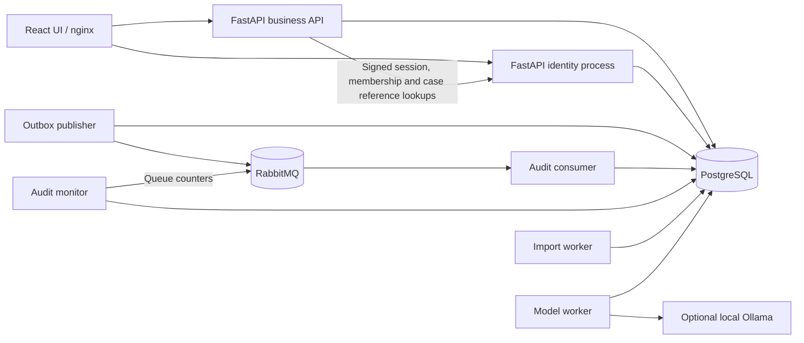
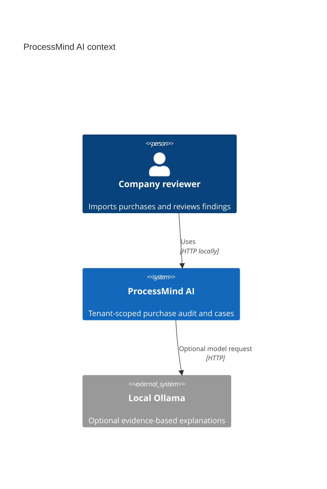
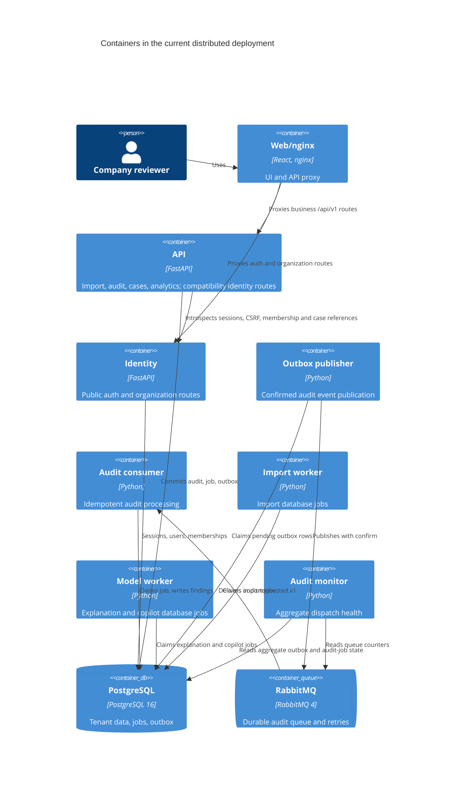
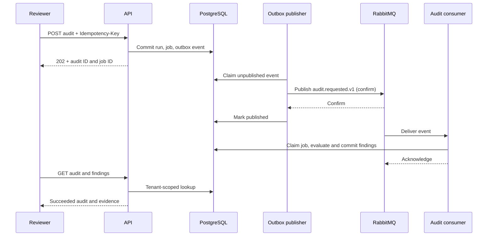

# Target state

The target is a set of **logical boundaries**, extracted into independently deployed services only when ownership and operational benefit justify the split. The first executable increment retains the modular API and database, while moving audit dispatch to RabbitMQ with a transactional outbox.

| Boundary | Current owner | Possible later extraction |
| --- | --- | --- |
| Client edge | nginx + FastAPI middleware | Consolidated gateway when routing across independently deployed APIs is needed |
| Identity | dedicated process and `identity` schema with a scoped runtime credential | Physically separate identity database if operations justify it |
| Import and audit | `features/ingestion`, `features/audit` | Audit service; owns purchases, audit runs, findings and event outbox |
| AI explanation and copilot | dedicated model worker process, `features/ai` and `features/copilot`, shared business schema | AI analysis service with owned data and versioned evidence contracts after independent scaling/security need |
| Notification | None | Worker only after a real notification use case exists |
| Analytics | `features/analytics` | Worker/materialized projections only if query load warrants it |

Redis, a custom gateway, notification and analytics workers are not included in the first increment. The current PostgreSQL instance hosts separate schemas and runtime credentials. Identity and business remain in one instance and share a Python image; independently deployed services do not read another owner's private tables. Shared-transaction modes are retained only for rollback with the administrative credential.

The broker uses durable queues, persistent messages, publisher confirms, manual consumer acknowledgment, retry with delay, and a dead-letter queue. A committed outbox record is the source for publication; delivery is **at least once**. The audit job remains the idempotency and status record, so duplicate messages cannot produce duplicate findings. `tenant_id` is checked against the job and run before processing. Public HTTP routes and authorization remain unchanged.

See `event-catalog.md` for the first real event and `migration-plan.md` for sequencing.

## C4 views of the current distributed deployment

