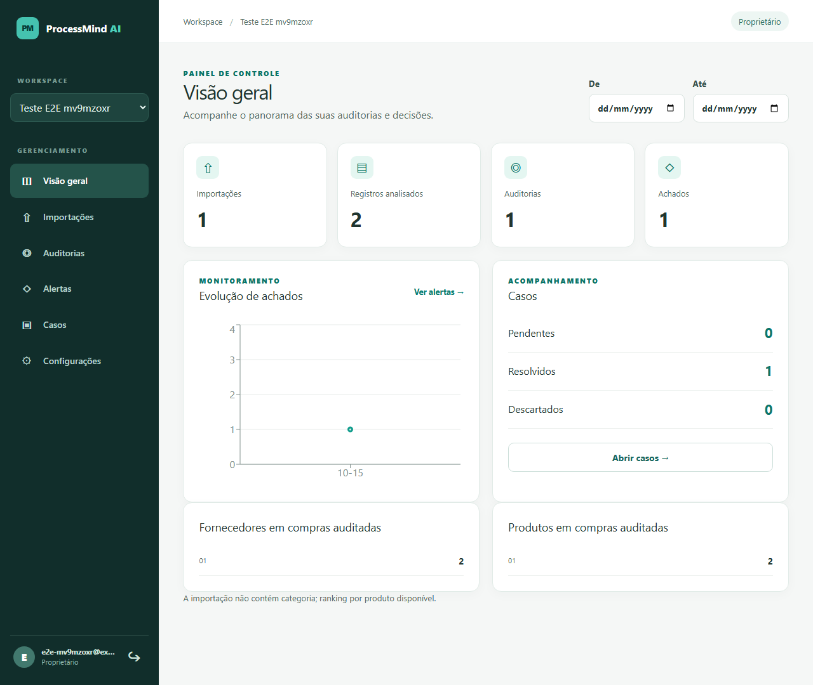
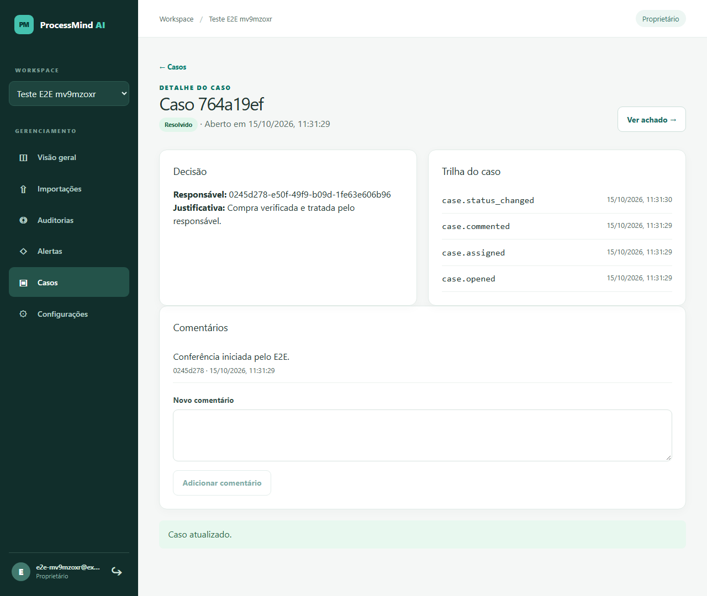

# Guia de uso e demonstração

Comece pela [instalação local](installation.md). O exemplo [`compras-exemplo.csv`](../examples/compras-exemplo.csv) contém duas compras sintéticas com os mesmos atributos e IDs distintos; a regra `DUPLICATE` deve produzir um achado após a auditoria. Nenhum dado real é necessário.

## Roteiro de 10 minutos

1. Em <http://localhost:5173>, selecione **Criar conta** e cadastre um usuário de demonstração. Crie uma organização com nome e identificador únicos.
2. Abra **Importações**, escolha `examples/compras-exemplo.csv` e selecione **Enviar arquivo**. Abra a importação e confira a prévia.
3. No mapeamento, associe cada campo obrigatório à coluna de mesmo nome: `purchase_id`, `supplier_id`, `purchase_date`, `product_id`, `quantity`, `unit_price`, `currency` e `total_amount`. Confirme e aguarde **Concluído**. O worker processa a importação; erros de linha aparecem no detalhe.
4. Abra **Auditorias**, marque a importação concluída e selecione **Executar auditoria**. Aguarde o término e abra a execução. As regras são determinísticas e independem de IA.
5. Abra o achado `DUPLICATE` em **Alertas**. Consulte as evidências, selecione **Abrir caso**, atribua a si mesmo e adicione um comentário. Escolha **Resolvido**, escreva uma justificativa e salve a decisão.
6. Volte à **Visão geral**. Confira o total de uma auditoria, um achado e um caso resolvido. O painel é derivado dos dados persistidos da organização.

O detalhe do caso mostra atribuição, comentários e histórico. A opção de explicação por IA no achado é complementar e exige Ollama configurado; uma falha de IA não altera o resultado da auditoria.

## Conjuntos sintéticos maiores

Na raiz do repositório, com Python 3.12:

```powershell
python scripts/generate_synthetic.py --size 100 --seed 42 --output-dir synthetic-output
```

Os tamanhos aceitos são `100`, `1000`, `10000` e `50000`; a semente reproduz o mesmo CSV e gabarito JSON. Acrescente `--xlsx` para gerar planilha. `synthetic-output/` é ignorado pelo Git. Ao importar esses arquivos, mapeie colunas pelos mesmos nomes e consulte os erros de normalização antes de interpretar os achados. A [avaliação das regras](../specs/testing/audit-evaluation.md) explica os casos esperados; o [relatório de carga](../specs/testing/phase7-load-report.md) apresenta os tempos medidos.

## Capturas da demonstração





As capturas vieram do E2E em uma instalação com volumes novos. Nomes, IDs e datas pertencem a dados sintéticos do teste.
