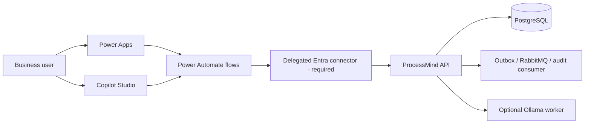

# Architecture

## Verified current application

The React/Vite UI uses nginx as its gateway. FastAPI identity and business
processes share PostgreSQL with separate schemas/roles. A session cookie,
CSRF token and active organization membership protect tenant data. Imports of
CSV/XLSX become persisted jobs. `POST /api/v1/organizations/{org}/audits` returns
202 and an audit ID; worker/outbox/RabbitMQ dispatch determines later status.
Deterministic audit rules create findings and evidence. Optional local Ollama
supports explanations and the existing copilot, whose answers require validated
evidence citations. See root `README.md`, `specs/architecture/copilot-v2.md`,
`organization-copilot-agent-v1.md` and `audit-events-v1.md`.

## Proposed integration

The Python client is the executable local equivalent of `F -> B`: it logs in
as an actual ProcessMind user, keeps the cookie and CSRF token in memory, and
sends only organization-scoped requests. It is **not** a public cloud gateway.

## Trust boundaries

The organization ID supplied by an app or agent is untrusted. ProcessMind must
derive the user from a validated session and check active membership for every
resource query. Power Platform permissions and agent instructions cannot replace
that check. The current API has no delegated Entra/OIDC login. A custom connector
using a shared technical account would collapse user authorization and must not
be used. Deployment requires a small identity extension that verifies Entra
tokens server-side and maps Entra subject to a ProcessMind user/membership, or a
separately reviewed per-user session broker. No such extension is included in
this isolated variant because it would alter the protected identity boundary.

The backend remains source of truth for imports, audits, findings, citations and
conversation turns. The agent never computes findings. No business copy belongs
in Dataverse in this version. Only bounded summaries and verified citation IDs
cross into Microsoft services; security review must decide retention and DLP.

## Actual HTTP contract used by the local client

| Operation | Endpoint | Semantics |
| --- | --- | --- |
| Login | `POST /api/v1/auth/login` | Session cookie + CSRF in JSON |
| List audits | `GET /api/v1/organizations/{org}/audits?limit=50` | Paginated |
| Get audit | `GET /api/v1/organizations/{org}/audits/{id}` | Status |
| List findings | `GET /api/v1/organizations/{org}/findings?audit_id={id}&limit=50` | Paginated evidence |
| Request audit | `POST /api/v1/organizations/{org}/audits` | 202, `Idempotency-Key`, CSRF |
| Start chat | `POST /api/v1/organizations/{org}/ai/copilot/conversations` | Temporary, completed audit |
| Ask | `POST /api/v1/organizations/{org}/ai/copilot/conversations/{id}/questions` | 202, idempotent |
| Poll answer | `GET /api/v1/organizations/{org}/ai/copilot/questions/{id}` | Status and verified citations |

The route contracts are verified against the current FastAPI source and specs;
cloud importability has not been validated.
